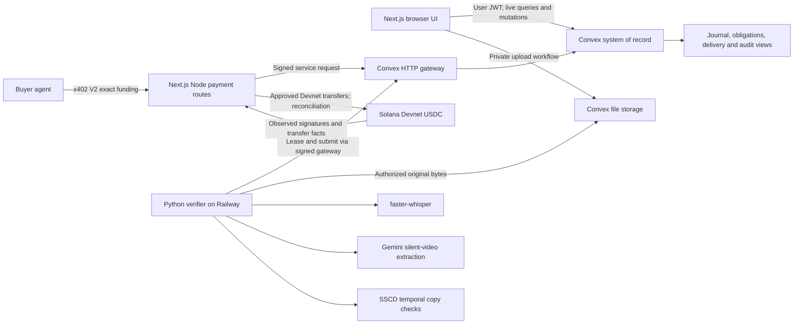

# Architecture

## System boundaries

This is the **target architecture**. The current shell does not connect these services. A browser fetches media through an authenticated backend path rather than receiving a long-lived unprotected storage URL. The Python worker uses a purpose-limited service identity, not a user's session or an admin key.

## Technology choices

| Boundary | Choice | Reason / tradeoff |
| --- | --- | --- |
| Web | Next.js App Router, React, TypeScript | One app for buyer, contributor and operator views; Node routes accommodate x402. Server-render by default. |
| Source of truth | Convex | Atomic mutations, reactive queries, native scheduler and file storage avoid synchronizing several databases. |
| Identity | Auth0 via Convex JWT integration | Standard identity boundary and a useful MLH track; retain already working auth if replacing it threatens the demo. |
| AI runtime | Python 3.11 worker on Railway | FFmpeg, ASR and copy-model ecosystem; separate from browser/request lifetimes. |
| Visual reasoning | Gemini 3.8 Flash, configurable | Current stable multimodal and structured-output model; model evidence requires independent validation. |
| Speech | faster-whisper, initially CPU int8 | Word times and independent narration trace without requiring a large GPU. |
| Copy detection | SSCD frame features and temporal alignment | Detect copied footage, not merely semantically similar legitimate retakes. |
| Money | Solana Devnet USDC; x402 V2 `exact` | Machine-payable order funding with a real chain settlement boundary. |
| Accounting | Deterministic TypeScript journals | Testable exact arithmetic and audit trail; the agent reasons over books instead of inventing them. |

Core JavaScript dependencies are installed and locked. The Solana SDKs, x402, Auth0 and model runtimes are **integration choices, not installed working features**. Install compatible, scoped SDK versions when those adapters are built; see [payments](payments-solana.md). Python ML extras remain optional to keep core tests light.

## End-to-end sequence

1. Create an immutable task/rubric version and order using an authenticated mutation.
2. Issue an x402 requirement for a short funding endpoint. The route checks ownership, state, quote expiry and exact amount before settlement. Its handler stages an intent; post-settlement confirmation records funding atomically. Never hold this paid HTTP response open while analysing a video.
3. Record on a secure browser origin; negotiate MediaRecorder codecs. Upload one original at an application cap of 25 MB, hash it and pin the task version. Store consent scope separately from the media bytes.
4. An atomic mutation creates the submission and job. Python claims a leased job with an incremented fencing generation. Lease expiry permits reclaiming work; stale workers cannot publish results.
5. Preserve source timestamps, extract silent visual events, transcribe audio independently, align claims, compare copy fingerprints and validate the report against the shared schema.
6. Publish immutable analysis metadata. An acceptance mutation checks authorization, current order state, source identity, rubric version, consent and remaining funded quota. Persist decision and outbox work atomically.
7. Publish buyer delivery access/manifest. Revenue recognition follows delivery under the documented principal assumption. Accepted-but-not-delivered work must not silently become recognized revenue.
8. Approved payment commands execute outside the Convex mutation. Store attempts and signature observations, reconcile uncertain outcomes and post each financial event once.

## Consistency and failure handling

A Convex mutation is the local atomic boundary. Network inference and blockchain operations are outside it. Durable intent/outbox records bridge that boundary. An indexed lookup plus write in the **same serializable mutation** implements app-level deduplication; an index name alone is not a unique constraint.

Use stable business IDs for funding, fulfillment, payables and refunds. Blockchain observations have their own identity `(network, signature, instructionPath)` because one transaction can contain more than one transfer. Matching both identities prevents duplicate import and duplicate business fulfillment. See [backend](backend.md) for exact storage fields and lease rules.

Do not reissue a transfer after an HTTP/RPC timeout. Re-query its signature and blockhash lifetime first. An accepted submission arriving during order cancellation competes in the same transactional order state: only one can allocate the remaining prepaid balance.

## Performance and cost strategy

Use 10–30 second clips and a fixed task. Start with sparse visual extraction and denser event-window rechecks; Gemini's default video sampling may miss short actions. Cache by original hash + task version + pipeline version. Record token use, latency, retry counts and actual vendor costs; do not label an illustrative API calculation as measured economics.

Start one Python worker and a native Convex job table. Adopt Workpool or Workflow only for a demonstrated orchestration need. Keep raw media out of model-facing text logs and avoid unbounded retries.
