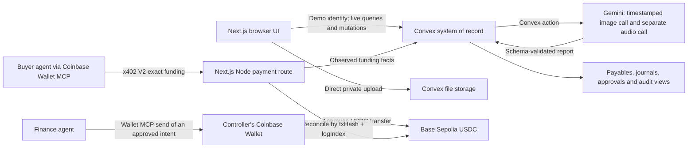

# Architecture

## System boundaries

This is **tonight's target architecture** (see [workstreams](workstreams.md)). The current shell does not connect these services yet. The browser fetches media through an authenticated backend path rather than a long-lived unprotected storage URL. **Payouts are approved and signed in the human controller's Coinbase Wallet; there is no treasury hot key in the web runtime or the agent, and no custom Solidity or escrow contract.**

**Deferred design** (kept in the subsystem docs, not built for the demo): a Python verifier worker on Railway with an HMAC service gateway and leased jobs, faster-whisper transcription, SSCD temporal copy detection, and refunds.

## Technology choices

| Boundary | Choice | Reason / tradeoff |
| --- | --- | --- |
| Web | Next.js App Router, React, TypeScript | One app for buyer, contributor and controller views; Node routes accommodate x402. Server-render by default. |
| Source of truth | Convex | Atomic mutations, reactive queries, scheduler, file storage and the Workflow component for the approval wait. |
| Identity | Seeded demo identities with server-checked roles in Convex | Labeled as demo. Auth0 is not used: Cal Hacks 13.0 has no Auth0 prize and it costs setup time. |
| AI runtime | Convex action calling Gemini | No second service to deploy. Two separate calls keep the visual and audio evidence independent. |
| Visual and finance reasoning | `gemini-3.8-flash`, model IDs configurable | Billing-enabled probes now succeed; earlier free-tier failures remain historical. No automatic model fallback. |
| Speech evidence | `gemini-3.5-transcribe`, model ID configurable | Separate verbatim audio observations; narration is withheld from the visual call. |
| Duplicate detection | SHA-256 + sampled-frame perceptual hash | Catches exact and re-encoded copies. SSCD is deferred (an image model; calibrating it needs labeled data). |
| Money | Base Sepolia USDC; x402 V2 `exact` via the CDP facilitator; Coinbase Wallet MCP | Machine-payable order funding and agent-initiated payouts, with a human approving every write. |
| Accounting | Deterministic TypeScript journals (`packages/ledger`) | Exact arithmetic and audit trail; the agent reasons over the books instead of inventing them. |

Core JavaScript dependencies are installed and locked. The x402 packages (`@x402/evm`, `@x402/next`, `@x402/paywall`) and the Gemini SDK are **integration choices, not installed working features**; see [payments](payments.md) for version and peer notes.

## End-to-end sequence

1. Create an immutable task/rubric version and order using an authenticated mutation.
2. Issue an x402 requirement for a short funding endpoint. The route checks ownership, state, quote expiry and exact amount before settlement. Its handler stages an intent; post-settlement confirmation records funding atomically. Never hold this paid HTTP response open while analysing a video.
3. Record on a secure browser origin; negotiate MediaRecorder codecs. Upload one original (cap: 25 MB), hash it and pin the task version. Store consent scope separately from the media bytes.
4. An atomic mutation creates the submission and schedules the analysis action. Before any model call, the SHA-256/perceptual hash is compared with accepted submissions; a match blocks a second payable and routes to the controller.
5. The action concurrently sends timestamped JPEG frames and separately extracted audio to independent Gemini calls, aligns the claims, and validates the report against the shared schema. A failed or invalid analysis routes to review.
6. Publish immutable analysis metadata. An acceptance mutation checks authorization, current order state, source identity, rubric version, consent and remaining funded quota. Persist decision and outbox work atomically.
7. Publish buyer delivery access/manifest. Revenue recognition follows delivery under the documented principal assumption. Accepted-but-not-delivered work must not silently become recognized revenue.
8. The controller approves the payout in Coinbase Wallet, outside the Convex mutation. Store attempts and tx-hash observations, reconcile uncertain outcomes and post each financial event once.

## Consistency and failure handling

A Convex mutation is the local atomic boundary. Network inference and blockchain operations are outside it. Durable intent/outbox records bridge that boundary. An indexed lookup plus write in the **same serializable mutation** implements app-level deduplication; an index name alone is not a unique constraint.

Use stable business IDs for funding, fulfillment, payables and refunds. Chain observations have their own identity `(network, txHash, logIndex)` because one transaction can emit more than one USDC `Transfer`. Matching both identities prevents duplicate import and duplicate business fulfillment. See [backend](backend.md) for exact storage fields.

Do not reissue a transfer after an HTTP/RPC timeout. Re-query the original tx hash (and its nonce) first. An accepted submission arriving during order cancellation competes in the same transactional order state: only one can allocate the remaining prepaid balance.

## Performance and cost strategy

Use 10–30 second clips and a fixed task. Start with sparse visual extraction and denser event-window rechecks; Gemini's default video sampling may miss short actions. Cache by original hash + task version + pipeline version. Record token use, latency, retry counts and actual vendor costs; do not label an illustrative API calculation as measured economics.

The shared Gemini transport applies one 30-second whole-request deadline across
at most three transient attempts, including response reads and backoff. Finance
rounds use that same bound within a two-minute overall run budget. Quota or
capacity failures stay explicit; switching models requires an environment change
and a new attributed measurement.

Use the Convex Workflow component for the approval wait, so it survives restarts and shows a real Convex feature. Keep raw media out of model-facing text logs and avoid unbounded retries.
