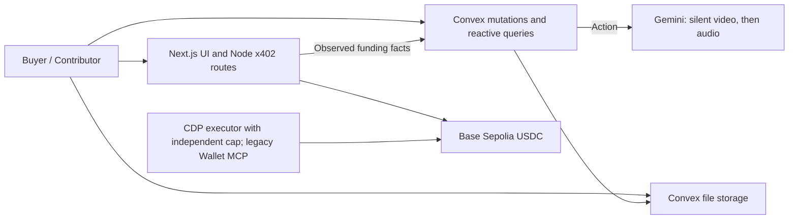

# Backend Architecture

## Implementation status

Task 1 is deployed to **https://keen-marmot-986.convex.cloud** with an idempotent
internal seed, persisted demo-role checks, server finance mutations and dashboard
queries. The generated API/data-model files are committed. Task 2 adds upload creation/scheduling, isolated media, Gemini observations and validated
report persistence (see [AI verification](ai-verification.md)). Additive Convex
Auth sign-in is implemented in source; operator setup and deployment remain
required (see [authentication](auth.md)). The dated Task 1 snapshot does not
establish the status of later private-media or wallet integrations.
The merged payment adapter implements trusted funding/payout confirmation and
chain reconciliation with synthetic-evidence tests; no live settlement is confirmed.
See [payment integration](payments.md) for the current contract.
The seed creates an **unfunded** order; it performs no transfer or inference.

The architecture targets Hyphenate, meaningful Convex use, Coinbase Best Use of
x402 (Base Sepolia, Wallet MCP) and Gemini. **Tonight's build** follows
[workstreams](workstreams.md): seeded demo identities, a Gemini Convex action,
and `acceptAndPublish` / `proposePayment` / `approve`.

**Deferred** (design kept below for later): the Python worker, its HMAC
gateway and job leasing (`claimJob`, `heartbeatJob`, fencing), faster-whisper,
refunds (`cancelRemainder`) and period close.

## Task 1 client contract

Initialize a Convex client with `https://keen-marmot-986.convex.cloud`. Browser
projects use `NEXT_PUBLIC_CONVEX_URL`; server clients use `CONVEX_URL`. Put these
in your own ignored `.env.local`. No deploy key is needed for public API calls.
Use generated imports from `convex/_generated/api`; relative import depth depends
on your folder. Nothing under `apps/web` was implemented by this backend task.

```ts
import { ConvexHttpClient } from "convex/browser";
import { api } from "../convex/_generated/api";

const client = new ConvexHttpClient("https://keen-marmot-986.convex.cloud");
const context = await client.query(api.dashboard.demoContext, { demoIdentity: "controller" });
if (!context) throw new Error("Run the internal demo seed first");
const summary = await client.query(api.dashboard.orderSummary, {
  demoIdentity: "controller", orderId: context.orderId,
});
```

Public `demoIdentity` values are `buyer`, `contributor`, `controller`,
`finance-agent`; their stored token identifiers are `demo:skarl:<identity>`.
For unsigned callers while demo mode is enabled, these selectors remain
intentionally impersonable demo credentials, **not auth**. Signed-in callers use
only their own `auth:<userId>` membership; `demoIdentity` is ignored and cannot
escalate their role. `SKARL_DEMO_IDENTITIES=off` disables the unsigned fallback.
See [authentication](auth.md) for sign-in, role claims and legacy controller onboarding.
`requireRole` checks active memberships and organization status; finance-agent
cannot act as controller even if misprovisioned with that role. The internal
seed bootstrap is CLI/operator-only and provisions the initial roles before its
controller check. Do not use real funds or private user data on this demo API.

| Function | Arguments (in addition to `demoIdentity`) | Result / permission |
| --- | --- | --- |
| `dashboard.demoContext` | None | Organization/order/rubric IDs and `demoOnly`; any seeded member |
| `dashboard.orderSummary` | `orderId` | `order`, frozen `rubric`, exact account `balances`; any seeded member in that org |
| `dashboard.submissions` | `orderId` | Submissions with analysis projection, decision and inline delivery manifest; controller/agent see order, contributor sees own, buyer sees their own order’s work |
| `dashboard.payables` | `orderId` | Obligations with outgoing intent, command and approval; controller/agent see order, contributor sees own; buyer sees their own order |
| `dashboard.journal` | `orderId` | Entries and ordered journal lines; owning buyer or controller/finance-agent |
| `dashboard.auditEvents` | `orderId` | Order-linked decision/refusal events, newest first; owning buyer or controller/finance-agent |
| `finance.acceptAndPublish` | `submissionId` | Order’s buyer or legacy controller; `{ok:true,payableId,deliveryId,journalEntryId,replayed}` or refusal |
| `finance.proposePayment` | `payableId` | Finance-agent/controller; `{ok:true,intentId,paymentCommandId,replayed}`; requester comes from membership |
| `finance.approve` | `intentId` (a `paymentIntents` document ID) | Buyer of this order or legacy independent controller; `{ok:true,approvalId,paymentCommandId,replayed}` or refusal |

Dashboard monetary fields and counters are decimal integer strings, for example
`amountAtomic: "7500000"`, not floating dollars. Mutations store/compute `bigint`
Int64 money. Default order `skarl-red-cup-demo-v2` has a 10,000,000 micro-USDC
budget, quota 4, sample price 2,500,000 and contributor rate 1,875,000. The
legacy v1 order remains unchanged at budget 100,000,000, quota 10, sample price
10,000,000 and contributor rate 7,500,000. Budget is not funded cash.

Acceptance requires an open funded order, remaining quota, verified original
asset and contributor wallet record, consent, frozen matching rubric and a
matching stored completed-inference `accept` projection. Alternatively it honors
a recorded, evidence-bound decision by the order’s buyer or a legacy independent human controller.
No public manual-decision recording endpoint is supplied in Task 1. Full model report validation/rubric membership now runs in Task 2 before
analysis persistence. The finance mutation consumes its trusted stored projection;
it does not itself call a model.

Acceptance publishes an inline licensed manifest and records its hash together
with delivery/payable/journal in one mutation. Media serving is still a separate
integration. Matching SHA-256 or canonical perceptual-hash values against an
already accepted submission in the same organization blocks a second payable,
including across orders. Task 2 computes server-side six-frame dHashes and adds bounded Hamming candidate
matching. Client-reported fallback evidence is labeled. This remains a heuristic
copy gate, not a demonstrated robust copy-detection model. See the AI document.

Refusals return `{ok:false,code}`. A duplicate also returns
`matchingSubmissionId` and writes `acceptance_refused` with that ID as evidence.
`self_approval_refused` and `agent_approval_refused` write
`payment_approval_refused`. Identical refusals are audit-idempotent. Callers must
inspect `ok`; these returns preserve the audit instead of rolling it back by
throwing. Invalid query authorization throws. Cross-tenant mutations return
`not_found` and do not write into the foreign organization's audit.

Outgoing `paymentIntents.kind === "contributor_payout"` rows contain
`requesterTokenIdentifier`, `payableId`, `paymentCommandId`, fixed amount,
recipient, source-version/binding hash and one-hour expiry. Existing funding
intents retain their original shape (`kind` absent or `funding`); payment owners
must narrow this discriminant. Proposal replay returns the original intent and
requester. The current flow is finance-agent proposal followed by buyer-signed deterministic policy approval; failed checks go to the order’s buyer. Legacy controller approval remains compatible. A controller-created proposal cannot be self-approved; expired or blocked proposals require a separate explicit recovery path (not implemented in Task 1), rather than silently rewriting the requester. Approval checks the exact payable/command/intent bindings, refuses
changed or expired proposals, updates intent/command and atomically signals the
Convex approval Workflow. The Workflow revalidates and queues one dispatch
outbox event asynchronously. The payable becomes `payout_in_progress`, **not paid**. Replaying
approval creates no second approval or dispatch. No wallet call occurs.

The payment integration must consume an approved command, validate its binding
and expiry again before execution, store the attempt, and independently observe
the transfer before posting a payout. For funding, a future trusted confirmation
mutation must use `lib/finance.recordJournal` with `createFundingJournal` and
mark the order funded atomically. No public caller-supplied funding-success
mutation is included. The seed does not invent funds or a wallet proof.

## Runtime boundaries



- **Convex:** authoritative order terms, submissions, analysis metadata, human
  decisions, approvals, journals, payment commands, recovery state, and audit
  history. Its live queries power the buyer and contributor views.
- **Next.js Node routes:** the x402 HTTP boundary and future payment/RPC adapters.
  They report payment observations to Convex rather than maintaining another
  ledger. They do not publish an order from an unverified client receipt.
- **Gemini analysis action (Convex):** validates and analyzes media, produces evidence, and
  stores a schema-validated report. It has no acceptance, accounting, approval, or
  signing authority. (The Python worker is deferred.)
- **Buyer-signed policy and independent CDP cap:** the finance agent prepares an exact proposal; internal `policy-engine` applies the buyer’s rule, and `PAYOUT_EXECUTOR=cdp_agent` hands the approved intent to the existing executor. Exceptions go to buyer Review. Legacy Coinbase Wallet/MCP signing remains compatible. Reconciliation verifies the resulting `Transfer` log.
- **Storage:** private originals, normalized media, evidence frames, reports,
  and licensed manifests. A published manifest changes the buyer's application
  access; it does not require making originals globally public.

No PostgreSQL, Redis, vector database, R2 bucket, custom token, or escrow contract
is required for the bounded MVP. A platform wallet plus database liabilities is
**platform-held refundable prepayment**, not noncustodial escrow.

## Canonical identifiers and money

The shared configuration is `packages/contracts/src/chain.ts`:

- `PAYMENT_NETWORK`: `eip155:84532` (Base Sepolia, `PAYMENT_CHAIN_ID` 84532).
- `USDC_ADDRESS`: `0x036CbD53842c5426634e7929541eC2318f3dCF7e`.
- Precision: six decimal places. `100 USDC = 100_000_000` atomic units.

Convex stores all USDC amounts as `v.int64()` / JavaScript `bigint`. Ordinary
JSON transports use base-10 integer strings. Conversion must be explicit; never
coerce an amount to floating point. Gas (ETH) is tracked separately in wei
and never added to USDC totals.

`taskVersionId` references a `rubricVersions` document. Jobs and reports also
carry `sourceHash`, `pipelineVersion`, and `leaseGeneration`. These fields bind
a result to the actual bytes, terms, implementation, and current processing
attempt. Convex document `_id` values are the internal references; public order
and business idempotency identifiers are separate fields.

## Storage model

| Collections | Purpose |
| --- | --- |
| `organizations`, `memberships` | Tenant boundary and trusted human roles |
| `orders`, `rubricVersions` | Immutable funded terms and collection lifecycle |
| `submissions`, `consentRecords`, `mediaAssets` | Contribution, licensing evidence, file metadata |
| `jobs`, `analysisResults` | Durable analysis attempts and versioned evidence references |
| `reviewDecisions`, `deliveries` | Human acceptance and actual licensed delivery |
| `payables` | Compensation earned under the accepted terms |
| `paymentIntents` | Expected buyer funding and x402 business identity |
| `approvals`, `paymentCommands`, `paymentAttempts` | Independent authorization and external execution state |
| `chainObservations` | Inspected USDC `Transfer` logs and confirmation observations |
| `journalEntries`, `journalLines` | Balanced accounting events and reversals |
| `outboxEvents`, `auditEvents`, `serviceRequests` | Durable side-effect requests, accountability, signed-request replay handling |

The schema is intentionally explicit about these responsibilities. Task 1 implements the acceptance/proposal/approval transitions above; other
transitions remain planned. All indexes are lookup indexes,
**not unique constraints**. The future mutation must read an indexed business
key and perform all dependent writes within the same serializable transaction.

## Planned mutation boundaries

`acceptAndPublish`, `proposePayment` and `approve` are implemented in `finance.ts`. Other names below remain integration targets.

| Mutation | Required atomic changes |
| --- | --- |
| `finalizeSubmission` | Check tenant/contributor and stored file metadata; bind consent and task version; create job and audit event |
| `claimJob` (deferred) | Select eligible work; increment attempt and lease generation; set owner/expiry; record the claim result |
| `heartbeatJob` (deferred) | Extend only the current unexpired lease for the authenticated worker |
| `completeAnalysis` | Validate source hash/versions and the report (fencing deferred with the worker); check the duplicate hash; attach evidence and move submission to review |
| `acceptAndPublish` | Check human authority and open capacity; record decision and buyer-accessible delivery; accrue payable and balanced journals; insert outbox event |
| `proposePayment` | Agent or operator creates a proposal from current payable versions; server computes recipient/amount; never approves |
| `approve` | Check the buyer-signed policy or owning buyer/legacy controller (not the requester, never the agent identity); bind the exact proposal hash and expiry; record approval and dispatch event |
| `recordConfirmedSettlement` | Check independently inspected transfer identity; consume financial event key; post balanced journal and close the obligation |
| `cancelRemainder` (deferred) | Close remaining collection capacity; reserve the refundable obligation; create refund proposal and audit history |

Acceptance and cancellation must both read/update the same order record. That
conflict prevents one remaining unit from being accepted and refunded
concurrently. A raw upload, AI recommendation, or human click without a ready
licensed manifest does not count as completed delivery.

The worker's full report follows the canonical schema in
`packages/contracts/schemas/verification-report.schema.json`. `analysisResults`
stores a bounded projection plus a report storage reference. The projection's
`pipelineStatus` maps to the report's `pipeline.status`. A `scaffold`,
`ml_unavailable`, failed, or ungrounded result must never automatically qualify a
sample for compensation.

## Media and worker lifecycle

1. An authenticated contributor reserves a submission and obtains a native
   Convex upload URL. Binary video goes directly to storage, bypassing Next.js.
2. Finalization checks the uploaded object and records consent. A contributor's
   declared hash is an expectation, not verified provenance.
3. One Python pull worker claims the persisted job through the narrow gateway.
4. The worker downloads the job-scoped media and computes its SHA-256. It must
   match the job's expected `sourceHash` before analysis.
5. The worker validates actual codec, duration, dimensions, and audio; creates
   normalized media/evidence; and returns a versioned structured report.
6. Completion validates the current lease, bytes, rubric, pipeline version,
   report shape, and referenced assets in a short mutation.
7. A human reviews recommendations and exceptions. Accepted and licensed
   delivery creates the financial obligation through `acceptAndPublish`.

Use a 30-second, 720p, 25 MB clip cap initially. This is an application
scope choice. Keep original bytes and a mapping from normalized timestamps to
the original video so evidence links remain meaningful.

Jobs are at-least-once work. Claim in a short transaction and release the
transaction before model/network processing. Persist a lease owner, monotonically
increasing generation, expiry, heartbeat, attempt count, and sanitized error.
Reclaim expired leases. Reject completion from the old generation even if the
old worker eventually finishes. Completion retries with the same valid result
must return the recorded operation rather than duplicate it.

No worker HTTP gateway, job loop, or scheduler is implemented in this scaffold.
The exact proposed service-authentication protocol is in [security.md](security.md).

## Payments and accounting lifecycle

Buyer funding uses x402 v2 on Base Sepolia. It is a short purchase of a defined
collection order; it must not keep an HTTP request open while a person films or
the model analyzes a clip. Contributor payouts are separate buyer-policy-approved
USDC transfers, not x402 refund primitives.

By default, the x402 Next route adapter invokes its handler before settlement
(a `beforeHandlerSettlement` option reverses this; see [payments](payments.md)).
The handler may stage a payment intent, but must not mark funding received,
publish paid work, or post cash before settlement is confirmed. A verified
authorization alone is not cash. Persist logical payment identity before
execution and recover settlement/HTTP/database failure windows explicitly.

For the demo, assume Skarl sells the licensed sample as principal and purchases
the contributor's work. This is an explicit simulation policy, not an accounting
conclusion about a real company.

The following illustrative entries retain the legacy v1 amounts; the current
v2 demo amounts are in the [demo runbook](demo.md#finance-fixture).

| Business event | Debit | Credit |
| --- | --- | --- |
| Buyer funding confirmed | `asset:usdc` 100 | `liability:customer_prepayments` 100 |
| Accepted sample and manifest delivered | `liability:customer_prepayments` 10 | `revenue:dataset_sales` 10 |
| Contributor compensation earned | `expense:contributor_acquisition` 7.50 | `liability:contributor_payables` 7.50 |
| Contributor payout confirmed | `liability:contributor_payables` 7.50 | `asset:usdc` 7.50 |
| Remaining cancellation approved | `liability:customer_prepayments` 90 | `liability:customer_refunds` 90 |
| Buyer refund confirmed | `liability:customer_refunds` 90 | `asset:usdc` 90 |

Amounts in this explanatory table are USDC, while persisted values are integer
atomic units. The final 2.50 USDC spread excludes inference, infrastructure,
facilitator, network, and other costs. It is not net profit.

Account and journal-kind names match `packages/ledger/src/index.ts`. The implemented
storage adapter maps that package's `eventId` to `journalEntries.eventKey` and
each line's positive `debit` or `credit` to `side` plus `amountAtomic`, preserving `lineNumber`. Adding
verification or fee expense accounts requires extending both the ledger and
storage validators; those postings are not implemented here.

Every journal must have at least two valid lines, nonnegative atomic amounts,
exactly one positive debit or credit per line, and equal debit/credit totals.
Post entry, lines, source event identity, and obligation state together. Changes
to posted history require linked reversals. The schema does not enforce these
rules by itself.

Payment attempts retain the tx hash, sender nonce, and confirmation
observations. Track submitted, confirmed, and finalized separately. Never replace
an unresolved transaction solely because HTTP timed out. Verify chain ID, token
address, `from`, `to`, `value`, log index and receipt status against the approved
proposal.
Deduplicate by logical financial event and inspected onchain transfer identity.

## Scheduling, outbox, and reactive UI

Write an outbox event in the same mutation that makes its business decision.
Native scheduling plus the Workflow component (for the durable approval wait) is
the demo plan. Workpool can later bound retries/concurrency of Convex actions.
Neither runs Python or makes a chain transfer
atomic with Convex. Scheduled actions can have external side effects and are
not automatically retried by Convex.

Use live Convex queries for progress, review status, earnings, and order finance
summaries. Render persisted state; an optimistic button animation must not claim
that cash moved. HTTP actions calling multiple mutations are separate
transactions, even when one action awaits all of them.

## Required implementation tests

- Concurrent acceptance produces one delivery, payable, and balanced event.
- Acceptance racing cancellation cannot consume the same remaining obligation.
- Duplicate callbacks and replays do not repeat financial effects.
- A restarted worker can reclaim expired work; a stale completion is rejected.
- Task/source/pipeline mismatches cannot create an accepted delivery.
- Contributors and workers cannot accept their own work or approve settlement.
- Changed amount/recipient/version invalidates approval.
- Pending, failed, wrong-token, wrong-recipient, and forged-hash observations
  never mark an obligation paid.
- A lost response after settlement recovers the original payment rather than
  requesting a second one.
- The complete illustrative order closes with zero customer/contributor
  obligations and balanced books.

## Primary references

- [Convex schemas](https://docs.convex.dev/database/schemas)
- [Convex atomicity and serializability](https://docs.convex.dev/database/advanced/occ)
- [Convex types](https://docs.convex.dev/database/types)
- [Convex scheduling guarantees](https://docs.convex.dev/scheduling/scheduled-functions)
- [Convex file access semantics](https://docs.convex.dev/file-storage/serve-files)
- [Canonical x402 source](https://github.com/x402-foundation/x402)
- [CDP x402 facilitator](https://docs.cdp.coinbase.com/x402/seller/facilitator)
- [Circle USDC addresses](https://developers.circle.com/stablecoins/usdc-contract-addresses)

## Approval dispatch readiness

Payout proposals now carry `approvalWorkflowId`. A successful policy or buyer exception
`finance.approve` response means approval was recorded and signaled, not that
the execution outbox is already ready. Observe `dashboard.payables[].dispatchReady`
before calling the payment executor. `payments.claimPayout` refuses with
`dispatch_not_ready` until the Workflow releases that exact command; no attempt
is created by the refusal. See [durable approval wait](finance-agent.md#durable-approval-wait).
