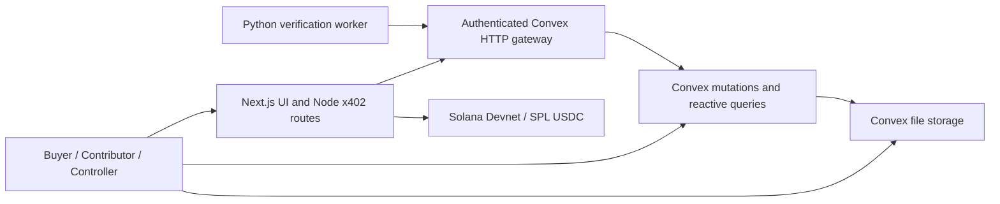

# Backend Architecture

## Implementation status

This repository contains a **scaffold**, not a working marketplace backend.
`convex/schema.ts` defines storage types and indexes. `convex/health.ts` exposes
only a non-sensitive scaffold query. Authentication, uploads, worker gateways,
domain mutations, scheduling, financial posting, and chain reconciliation still
need implementation and integration tests. No cloud deployment is implied.

The architecture targets Hyphenate, meaningful Convex use, and Solana settlement.
Coinbase Payment Agents eligibility still requires confirmation of the required
Solana-compatible agent/MCP integration. An x402 SDK or facilitator alone does
not establish that eligibility.

## Runtime boundaries

- **Convex:** authoritative order terms, submissions, analysis metadata, human
  decisions, approvals, journals, payment commands, recovery state, and audit
  history. Its live queries power the three personas' views.
- **Next.js Node routes:** the x402 HTTP boundary and future payment/RPC adapters.
  They report payment observations to Convex rather than maintaining another
  ledger. They do not publish an order from an unverified client receipt.
- **Python worker:** validates and analyzes media, produces evidence, and reports
  recommendations. It has no acceptance, accounting, approval, or signing
  authority.
- **Human controller wallet:** the proposed independent signing boundary for
  contributor payments and refunds. The finance system prepares an exact
  proposal; the human signs; reconciliation verifies the resulting transfer.
- **Storage:** private originals, normalized media, evidence frames, reports,
  and licensed manifests. A published manifest changes the buyer's application
  access; it does not require making originals globally public.

No PostgreSQL, Redis, vector database, R2 bucket, custom token, or escrow contract
is required for the bounded MVP. A platform wallet plus database liabilities is
**platform-held refundable prepayment**, not noncustodial escrow.

## Canonical identifiers and money

The shared configuration is `packages/contracts/src/solana.ts`:

- Network: `solana:EtWTRABZaYq6iMfeYKouRu166VU2xqa1`.
- Devnet USDC mint: `4zMMC9srt5Ri5X14GAgXhaHii3GnPAEERYPJgZJDncDU`.
- Precision: six decimal places. `100 USDC = 100_000_000` atomic units.

Convex stores all USDC amounts as `v.int64()` / JavaScript `bigint`. Ordinary
JSON transports use base-10 integer strings. Conversion must be explicit; never
coerce an amount to floating point. Native SOL fees use a separate lamport field
and are not added to USDC totals.

`taskVersionId` references a `rubricVersions` document. Jobs and reports also
carry `sourceHash`, `pipelineVersion`, and `leaseGeneration`. These fields bind
a result to the actual bytes, terms, implementation, and current processing
attempt. Convex document `_id` values are the internal references; public order
and business idempotency identifiers are separate fields.

## Storage model

| Collections | Purpose |
| --- | --- |
| `organizations`, `memberships` | Tenant boundary and trusted human roles |
| `orders`, `rubricVersions` | Immutable funded terms and collection lifecycle |
| `submissions`, `consentRecords`, `mediaAssets` | Contribution, licensing evidence, file metadata |
| `jobs`, `analysisResults` | Durable analysis attempts and versioned evidence references |
| `reviewDecisions`, `deliveries` | Human acceptance and actual licensed delivery |
| `payables` | Compensation earned under the accepted terms |
| `paymentIntents` | Expected buyer funding and x402 business identity |
| `approvals`, `paymentCommands`, `paymentAttempts` | Independent authorization and external execution state |
| `chainObservations` | Inspected SPL transfers and commitment observations |
| `journalEntries`, `journalLines` | Balanced accounting events and reversals |
| `outboxEvents`, `auditEvents`, `serviceRequests` | Durable side-effect requests, accountability, signed-request replay handling |

The schema is intentionally explicit about these responsibilities. It does not
make any of the planned transitions executable. All indexes are lookup indexes,
**not unique constraints**. The future mutation must read an indexed business
key and perform all dependent writes within the same serializable transaction.

## Planned mutation boundaries

These names describe work to implement; they are not callable functions yet.

| Mutation | Required atomic changes |
| --- | --- |
| `finalizeSubmission` | Check tenant/contributor and stored file metadata; bind consent and task version; create job and audit event |
| `claimJob` | Select eligible work; increment attempt and lease generation; set owner/expiry; record the claim result |
| `heartbeatJob` | Extend only the current unexpired lease for the authenticated worker |
| `completeAnalysis` | Fence stale attempts; validate source/versions and report; attach evidence and move submission to review |
| `acceptAndPublish` | Check human authority and open capacity; record decision and buyer-accessible delivery; accrue payable and balanced journals; insert outbox event |
| `approveSettlement` | Check an independent controller; bind the exact proposal hash and expiry; record approval and dispatch event |
| `recordConfirmedSettlement` | Check independently inspected transfer identity; consume financial event key; post balanced journal and close the obligation |
| `cancelRemainder` | Close remaining collection capacity; reserve the refundable obligation; create refund proposal and audit history |

Acceptance and cancellation must both read/update the same order record. That
conflict prevents one remaining unit from being accepted and refunded
concurrently. A raw upload, AI recommendation, or human click without a ready
licensed manifest does not count as completed delivery.

The worker's full report follows the canonical schema in
`packages/contracts/schemas/verification-report.schema.json`. `analysisResults`
stores a bounded projection plus a report storage reference. The projection's
`pipelineStatus` maps to the report's `pipeline.status`. A `scaffold`,
`ml_unavailable`, failed, or ungrounded result must never automatically qualify a
sample for compensation.

## Media and worker lifecycle

1. An authenticated contributor reserves a submission and obtains a native
   Convex upload URL. Binary video goes directly to storage, bypassing Next.js.
2. Finalization checks the uploaded object and records consent. A contributor's
   declared hash is an expectation, not verified provenance.
3. One Python pull worker claims the persisted job through the narrow gateway.
4. The worker downloads the job-scoped media and computes its SHA-256. It must
   match the job's expected `sourceHash` before analysis.
5. The worker validates actual codec, duration, dimensions, and audio; creates
   normalized media/evidence; and returns a versioned structured report.
6. Completion validates the current lease, bytes, rubric, pipeline version,
   report shape, and referenced assets in a short mutation.
7. A human reviews recommendations and exceptions. Accepted and licensed
   delivery creates the financial obligation through `acceptAndPublish`.

Use a 30-second, 720p, roughly 20–25 MB clip cap initially. This is an application
scope choice. Keep original bytes and a mapping from normalized timestamps to
the original video so evidence links remain meaningful.

Jobs are at-least-once work. Claim in a short transaction and release the
transaction before model/network processing. Persist a lease owner, monotonically
increasing generation, expiry, heartbeat, attempt count, and sanitized error.
Reclaim expired leases. Reject completion from the old generation even if the
old worker eventually finishes. Completion retries with the same valid result
must return the recorded operation rather than duplicate it.

No worker HTTP gateway, job loop, or scheduler is implemented in this scaffold.
The exact proposed service-authentication protocol is in [security.md](security.md).

## Payments and accounting lifecycle

Buyer funding uses x402 v2 on Solana Devnet. It is a short purchase of a defined
collection order; it must not keep an HTTP request open while a person films or
the worker analyzes a clip. Contributor payouts and refunds are separate checked
SPL USDC transfers, not x402 refund primitives.

The inspected x402 Next route adapter invokes its handler before settlement.
The handler may stage a payment intent, but must not mark funding received,
publish paid work, or post cash before settlement is confirmed. A verified
authorization alone is not cash. Persist logical payment identity before
execution and recover settlement/HTTP/database failure windows explicitly.

For the demo, assume Skarl sells the licensed sample as principal and purchases
the contributor's work. This is an explicit simulation policy, not an accounting
conclusion about a real company.

| Business event | Debit | Credit |
| --- | --- | --- |
| Buyer funding confirmed | `asset:usdc` 100 | `liability:customer_prepayments` 100 |
| Accepted sample and manifest delivered | `liability:customer_prepayments` 10 | `revenue:dataset_sales` 10 |
| Contributor compensation earned | `expense:contributor_acquisition` 7.50 | `liability:contributor_payables` 7.50 |
| Contributor payout confirmed | `liability:contributor_payables` 7.50 | `asset:usdc` 7.50 |
| Remaining cancellation approved | `liability:customer_prepayments` 90 | `liability:customer_refunds` 90 |
| Buyer refund confirmed | `liability:customer_refunds` 90 | `asset:usdc` 90 |

Amounts in this explanatory table are USDC, while persisted values are integer
atomic units. The final 2.50 USDC spread excludes inference, infrastructure,
facilitator, network, and other costs. It is not net profit.

Account and journal-kind names match `packages/ledger/src/index.ts`. The future
storage adapter maps that package's `eventId` to `journalEntries.eventKey` and
each line's `debit`/`credit` bigint values to `debitAtomic`/`creditAtomic`. Adding
verification or fee expense accounts requires extending both the ledger and
storage validators; those postings are not implemented here.

Every journal must have at least two valid lines, nonnegative atomic amounts,
exactly one positive debit or credit per line, and equal debit/credit totals.
Post entry, lines, source event identity, and obligation state together. Changes
to posted history require linked reversals. The schema does not enforce these
rules by itself.

Payment attempts retain signature, transaction digest, recent blockhash, last
valid block height, and commitment observations. Track `processed`, `confirmed`,
and `finalized` separately. Never replace an unresolved transaction solely
because HTTP timed out. Verify mint, precision, instruction path, token-account
owners, amount, success, and required commitment against the approved proposal.
Deduplicate by logical financial event and inspected onchain transfer identity.

## Scheduling, outbox, and reactive UI

Write an outbox event in the same mutation that makes its business decision.
Native scheduling plus a single pull worker is sufficient for the first demo.
Workpool can later bound retries/concurrency of Convex actions; Workflow can
coordinate durable human waits. Neither runs Python or makes a chain transfer
atomic with Convex. Scheduled actions can have external side effects and are
not automatically retried by Convex.

Use live Convex queries for progress, review status, earnings, and order finance
summaries. Render persisted state; an optimistic button animation must not claim
that cash moved. HTTP actions calling multiple mutations are separate
transactions, even when one action awaits all of them.

## Required implementation tests

- Concurrent acceptance produces one delivery, payable, and balanced event.
- Acceptance racing cancellation cannot consume the same remaining obligation.
- Duplicate callbacks and replays do not repeat financial effects.
- A restarted worker can reclaim expired work; a stale completion is rejected.
- Task/source/pipeline mismatches cannot create an accepted delivery.
- Contributors and workers cannot accept their own work or approve settlement.
- Changed amount/recipient/version invalidates approval.
- Pending, failed, wrong-mint, wrong-owner, and forged-signature observations
  never mark an obligation paid.
- A lost response after settlement recovers the original payment rather than
  requesting a second one.
- The complete illustrative order closes with zero customer/contributor
  obligations and balanced books.

## Primary references

- [Convex schemas](https://docs.convex.dev/database/schemas)
- [Convex atomicity and serializability](https://docs.convex.dev/database/advanced/occ)
- [Convex types](https://docs.convex.dev/database/types)
- [Convex scheduling guarantees](https://docs.convex.dev/scheduling/scheduled-functions)
- [Convex file access semantics](https://docs.convex.dev/file-storage/serve-files)
- [Canonical x402 source](https://github.com/x402-foundation/x402)
- [Solana x402 integration](https://solana.com/docs/payments/agentic-payments/x402)
- [Solana signature status](https://solana.com/docs/rpc/http/getsignaturestatuses)
- [Circle USDC mint addresses](https://developers.circle.com/stablecoins/usdc-contract-addresses)
