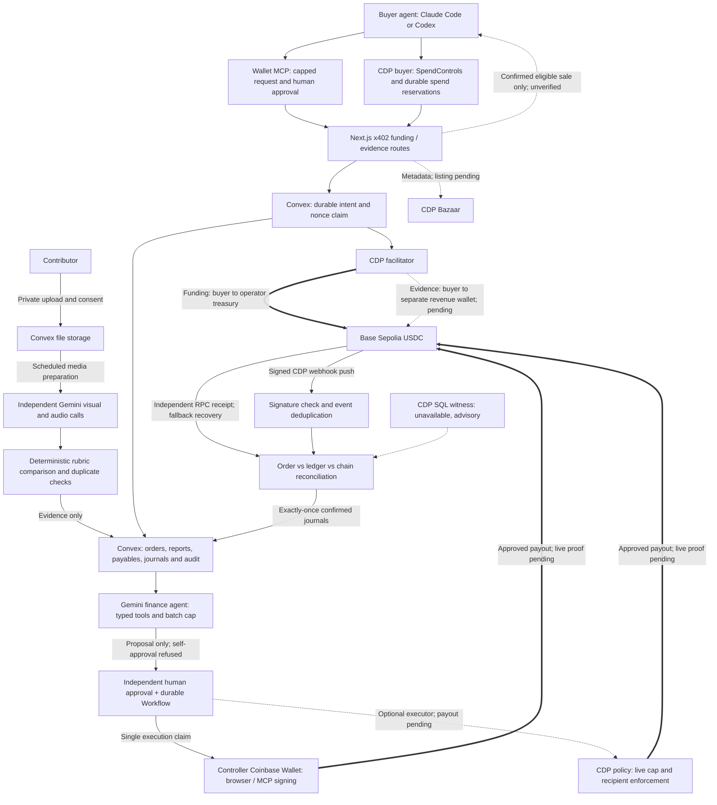

# Skarl — Coinbase Payment Agents submission

**Every claim has a witness.** Skarl is the autonomous settlement desk for human-data companies: independent witnesses must agree before anything moves. Agents argue the case, deterministic code decides, and humans approve exceptions. Every payout currently also requires independent human approval and wallet signing. The seats are **settlement accountant + AP clerk**.

[The thesis and witness table](thesis.md) separate live work/money evidence from simulated controls and pending integrations. The intended moment is a duplicate blocked before a second payable, refused agent self-approval, then controller approval in Coinbase Wallet and chain/ledger agreement. The complete live sequence remains pending; the receipts below prove funding.

[Hosted demo](https://skarl.vercel.app) · [Repository](https://github.com/stephenhungg/skarl) · [Two-minute demo and judging runbook](demo-script.md) · [Evidence log](status.md) · [Architecture SVG](architecture.svg)

**Testnet only: Base Sepolia and optional Solana Devnet funding, test USDC, demo identities, and the operator's own test float. No custody or management of anyone else's real funds.** Live below means an actual testnet/provider operation, not mainnet or production readiness. Evidence cutoff: [status](status.md), including October 25, 2026, 03:05 PDT policy verification, 03:29 PDT Solana funding, and the [04:40 evidence refresh](status.md#submission-evidence-refresh--october-25-2026-0440-pdt).

## 1. Project summary

Skarl serves AI teams buying short narrated demonstrations and operators who must determine what contributors are owed. Its narrow task is picking up a red cup, placing it on a coaster, and narrating the action. The finance seats are **settlement accountant + AP clerk**: prevent duplicate obligations, explain the books, propose payments and reconcile the result.

| Agent role | Core task and Coinbase tools | What is proven |
| --- | --- | --- |
| **PAY: buyer agent** | Funds an order through x402 V2 `exact`; production uses the CDP facilitator. The reusable Wallet MCP plugin uses `initiate_x402_request`, human approval, then `complete_x402_request`. A separate CDP SDK buyer uses `CdpX402Client` and `SpendControls`. | CLI x402 funding settled on Base Sepolia and Solana Devnet, including CDP-facilitated payments. The recorded payments were **not Wallet MCP purchases**. |
| **EARN: Skarl evidence service** | Sells an accepted, licensed sample's verification report and five-minute media access for 0.25 test USDC, paid to the separate `skarl-finance-agent` revenue wallet. The x402 endpoint declares CDP Bazaar metadata for agent discovery. | Endpoint and discovery declaration implemented; ineligible samples correctly return `404`. **Paid delivery and a CDP Bazaar listing remain pending.** |
| **MANAGE: finance agent** | Configurable Gemini/Claude function-calling agent in Convex reads obligations and journals, explains exceptions and proposes bounded batches. Controller Wallet/MCP signing is the default; an optional CDP Server Wallet executor adds Policy Engine caps and recipient restrictions to already approved intents. | Live Gemini and Claude read-only tool loops completed. Contributor wallet verification and a 2-USDC CDP policy are live; actual over-cap and non-allowlisted sends returned `403 policy_violation`. **No contributor payout has run.** |

**Agent platforms:** Claude Code or Codex with Coinbase Wallet MCP for the buyer interface; bounded Gemini/Claude tool loops running as Convex Node actions for finance. The [custom plugin](wallet-mcp-plugin/skarl.md) is reusable instruction context, not a Coinbase-certified or preinstalled plugin. Wallet MCP and CDP Server Wallet are separate execution surfaces.

## 2. Working example and reuse

### Start with the verified result

| Recorded live evidence | Judge can inspect |
| --- | --- |
| **0.01 test USDC via CDP**, October 25, 02:54 PDT | [BaseScan transaction](https://sepolia.basescan.org/tx/0x20c9252f7d67a2dac87be839ad82b83465686157478645354838ac0f7239390d), Transfer log **1**. Actual settlement log named `cdp`; real signed provider webhook returned 200, Convex stored `processed`, reconciliation returned `exceptions:[]`, and the 10000 micro-USDC journal balanced. [Full trace](status.md#confirmed-webhook-delivery-and-cdp-settlement--0254-pdt). |
| **10 test USDC via the public x402.org facilitator** | [BaseScan transaction](https://sepolia.basescan.org/tx/0x28b3f88d593c02a669cb95f4bdc6a23ab3d24bb5d1260e6c4ae54554155cd757). Seeded v2 funding is confirmed; reading it does not create another charge. |
| **1 test USDC on Solana Devnet via CDP**, 03:29 PDT | [Solana Explorer transaction](https://explorer.solana.com/tx/31LMrtZYcf4PcBRcyFmFX8tBmt2fNttNSBA4mz7sTrZKSw6E2kH9oghw5FTafzR77JZT9so1zzjkj8ZuVqrGUezi?cluster=devnet), finalized slot **514940239**, transfer instruction **2**. One bounded CDP SDK authorization; Convex funding confirmed with one reconciliation match and zero exceptions. [Full trace](status.md#confirmed-solana-funding-after-fee-payer-fix--october-25-2026-0329-pdt). |
| **CDP policy enforcement**, 03:05 PDT | Account `skarl-finance-agent` was funded with 3 test USDC; actual 2.000001-USDC over-cap and 0.10-USDC non-allowlisted sends returned HTTP 403 `policy_violation`, not simulations. Correlations: `a5006791aba9be62-IAD`, `a500679519ddbe62-IAD`. [Live policy trace](status.md#live-retry-after-recovery-deployment--october-25-2026-0305-pdt). |
| **Independent Gemini inference** | Real unrelated human-video negative: Flash visual 4,893 ms, Transcribe 1,322 ms; report correctly remained `needs_review`. This historical run used Flash, not the current Argon default. [Measurement](status.md#real-youtube-origin-clip-verification--october-25-2026). |
| **Live finance tool call** | Gemini read `getTrialBalance` and explained exact 10000000 debit/credit totals in 6,805 ms client time. No proposal, approval or transfer occurred. [Recorded run](status.md#task-3--clip-evaluation-harness). |

### Use Skarl from an agent in three steps

1. Connect Wallet MCP and complete its human onboarding. In Claude Code: `claude mcp add --transport http --scope user base-mcp https://wallet-mcp.coinbase.com`. In Codex: `codex mcp add base-mcp --url https://wallet-mcp.coinbase.com/`.
2. Give the agent [the Skarl plugin](wallet-mcp-plugin/skarl.md). It pins origin, chain, USDC, the operation-specific payee, amount and recovery behavior. An HTTP-capable harness can read the endpoint directly; chat-only surfaces also depend on Coinbase's host allowlist.
3. Ask: **“Check whether Skarl order skarl-red-cup-demo-v2 is funded.”** Expect `fundingStatus: "confirmed"`, `amountAtomic: "10000000"` and the 10-USDC transaction above. This completes the currently reproducible, no-charge agent task.

For a **new** payment, use a fresh operator-provided unfunded order ID and an explicit cap. The plugin supplies exact Wallet MCP arguments; the human approves in Coinbase Wallet, then the agent completes the same request ID and checks confirmed funding. Never repay the funded v2 order to manufacture a payment demo.

For evidence, ask **“Buy Skarl sample sample-SUBMISSION_ID's evidence for at most 0.25 USDC.”** Substitute a real accepted/delivered sample ID. The request is `GET https://skarl.vercel.app/api/samples/sample-SUBMISSION_ID/evidence`, `scheme: "exact"`, `maxPayment: "0.250000"`. Evidence pays `SKARL_EVIDENCE_PAYTO` (`skarl-finance-agent`, `0x0A9EfDF66c58543538824906aE267B969Ed651c5`), which must differ from the human payer and funding treasury. The web and Convex deployments must both have the new evidence-revenue accounting capability; old capability fails closed before payment. Follow the [Wallet MCP purchase runbook](wallet-mcp-demo.md) for testnet discovery, approval deadlines and same-request recovery. At the evidence cutoff no eligible sample exists: the correct result is to stop at `404 sample_unavailable`, with no payment. A future successful purchase must return HTTP 200, a confirmed transaction and the bound report; it must not be presented as completed today.

### Run the repository

```sh
git clone https://github.com/stephenhungg/skarl.git
cd skarl
# Node 22.18+ within the Node 22 line; pnpm 10.19.0
pnpm install --frozen-lockfile
pnpm check
pnpm dev
```

The local shell boots without secrets. For connected behavior, follow [setup](setup.md) and [deployment](deployment.md); runtime credentials are server-only. [Payments](payments.md) documents the original testnet CLI buyer, the CDP-managed buyer, funding/reconciliation and their different signing boundaries. [The demo script](demo-script.md) provides the two-minute sequence and labeled fallbacks. No finished video URL is recorded in the evidence log; attach the actual recording when submitting.

## 3. Architecture, controls and known limitations

### Components and flow

The diagram shows implemented paths and optional integrations; it is **not** a claim that every arrow ran live. Funding and signed webhook reconciliation ran live; outgoing payout and paid evidence/Bazaar discovery did not.



[Exported SVG](architecture.svg). Implementation detail: [payments](payments.md), [verification](ai-verification.md), [agent wallet](agent-wallet.md), [dashboard API](dashboard-api.md).

### Why these choices

Skarl treats the VLM as a sensor, not a judge. VL-RewardBench (CVPR 2025, [arXiv:2411.17451](https://arxiv.org/abs/2411.17451)) and MLLM-as-a-Judge (ICML 2024, [arXiv:2402.04788](https://arxiv.org/abs/2402.04788)) report that multimodal judges fail mostly at perception and drift on holistic scoring, so Gemini emits only structured, timestamped observations from silent frames, a separate model transcribes audio, and deterministic code applies a decomposed rubric mirroring the wrong-object / wrong-order / missing-step taxonomy of procedural mistake detection (Assembly101, CaptainCook4D, Ego-Exo4D). Every event must cite a sampled frame; the audio and video channels are independent and must agree; a two-model panel (after PoLL, [arXiv:2404.18796](https://arxiv.org/abs/2404.18796)) routes any disagreement to human review; nothing auto-accepts on failure. We report false-acceptance with Wilson 95% intervals and a risk-coverage operating point (selective prediction) instead of bare accuracy. Conformal abstention guarantees and SSCD/VSC-style copy detection are next.

The two Gemini judges share a model family, so consensus is not independent
proof of truth. The [04:40 evidence refresh](status.md#submission-evidence-refresh--october-25-2026-0440-pdt) confirms a stored live negative jury run; a labeled human corpus evaluation remains required. dHash does not cover
crop, flip, overlay or screen recapture.

| Decision | Reason and practical limit |
| --- | --- |
| **Models** | The default panel runs `gemini-4-argon` and `gemini-3.8-flash` on timestamped silent frames; `gemini-3.5-transcribe` receives separate audio. Narration cannot bias the visual call. A deterministic comparator applies the frozen rubric and routes visual disagreement or failure to review; no model decides payment. Argon's clearer visibility in a small directional probe motivated its visual role, while `gemini-3.8-flash` keeps finance/chat interactive. No labeled accuracy advantage is claimed. |
| **Tools** | Six allowlisted finance tools read obligations/statement/exceptions or prepare proposals and approval requests. Stored payables determine amount and destination. The model cannot sign or grant itself authority. Default bounds are 12 tool calls, 10 USDC cumulative proposals and a two-minute run budget. |
| **Memory** | Convex stores immutable terms, source-bound reports, persisted tool transcripts, proposals, approvals, attempts and journals. One transactional source of truth prevents competing copies of the budget; no vector store or second ledger is needed. |
| **Scheduling** | Submission mutations atomically schedule verification; a five-minute watchdog fences interrupted jobs into review. Each provider request has one 30-second deadline across retries. Convex Workflow durably waits for approval, revalidates it and queues one dispatch. Webhooks push chain events; RPC confirmation/recovery remains authoritative when push or SQL is unavailable. There is no perpetual autonomous spending loop. |

### Controls

- **Human approval and separation of duties:** independent controller approval binds exact amount, recipient, token, network, source and expiry. The proposer cannot approve; the finance-agent identity can never approve. Default payout signing requires the controller's browser wallet or Wallet MCP approval URL.
- **Independent wallet constraints:** optional CDP Policy Engine rules restrict network, USDC contract, zero native value, ERC-20 `transfer`, verified recipients and a per-transfer cap. Setup refuses project-level accepts that could bypass account restrictions. The 2-USDC account policy and two real send rejections are recorded live; other negative preflight cases are explicitly simulations. The cap is not a cumulative budget.
- **Buyer spending:** Wallet MCP `maxPayment` is a per-request cap. The separate CDP buyer's `SpendControls` pin the approved payee/token/network (treasury for funding; `SKARL_EVIDENCE_PAYTO` for evidence) and enforce per-call and locally persisted cumulative limits (20 USDC/24h by default); they are not an account-wide policy for all clients.
- **Durable claims:** order/business keys, payer authorization nonce, single payout claim and journal event keys prevent repeated dispatch/posting. A timeout preserves the original attempt for reconciliation, never authorizes another send.
- **Chain reconciliation:** successful canonical receipt, two confirmations, token, sender, recipient, exact amount and funding authorization nonce must match. Transfers deduplicate by `(network, txHash, logIndex)`. Order contract, ledger and chain disagreements become exceptions.
- **Signed webhooks:** raw-body signature validation and durable event/transfer deduplication precede trusted receipt reconciliation. SQL remains an advisory witness and cannot authorize money.
- **Evidence and privacy:** completed, source/rubric-bound inference plus consent, delivery and duplicate checks gate acceptance. Incomplete/scaffold results cannot recommend acceptance. Media and model text cannot change roles, recipients or tools. No controller key enters the web runtime or agent context; original media and credentials stay out of Git.

### Known limitations

1. **The complete earn-and-payout loop has not run live.** Wallet MCP purchase, eligible sample sale, Bazaar listing and contributor payout remain unverified at the evidence cutoff. The deployed signature fix enabled live contributor registration and policy enforcement, but there is still no accept-eligible submission, payable or independently approved payout intent. The optional executor remains disabled.
2. **Demo identity selectors are impersonable.** Server role checks demonstrate policy, not production authentication. Operator-owned test assets and demo identities are the entire funds scope.
3. **Evidence-sale accounting is implemented but not live-proven.** New code debits separate `asset:evidence_usdc` and credits `revenue:evidence_sales` when bound licensed content remains available, or `liability:evidence_receipts` when unavailable. It preserves the receiving wallet and leaves order prepayments, quota and contributor obligations unchanged. This availability-based recognition does not prove download. Both deployments must include the new schema/handlers before payment; automatic redelivery, deferred-revenue release and sale refunds remain unfinished. A lost response requires operator recovery without repaying.
4. **AI quality is unmeasured.** Live negative smoke tests and a directional frame probe are not a human-task benchmark. Monotonic dHash alignment has local re-encode and synthetic shifted-sample regressions; crop, flip, overlay and screen recapture are not covered. Speed robustness and independent-retake false positives are uncalibrated.
5. **Recovery still needs an operator in some cases.** SQL is unavailable; exhausted webhook retries or a lost payout hash do not have a general background repair worker. A successful approval or submitted hash is not a paid payable.
6. **Demonstrated payments are testnet funding only.** Base Sepolia remains primary; one live 1-USDC Solana Devnet funding is now confirmed. Payouts remain Base-only. The diagram shows the Base path. No real-money deployment, custom smart contract, escrow contract or production custody service is claimed. `/api/health` is a static scaffold payload, not integration readiness.

## 4. Builder feedback

### Biggest observed blocker: SQL unavailable even for SELECT 1

At approximately 02:54 PDT, every recorded query to `/platform/v2/data/query/run` returned HTTP 500, including client-key and API-secret-JWT `SELECT 1`. CDP returned `internal_server_error`. Correlation IDs: client-key **`a50055b9eb2f354e-IAD`**, JWT **`a50055baacf2354e-SJC`**, scoped Base Sepolia Transfer query **`a50055bbcc0b7851-IAD`**. These are actual provider errors in [status](status.md#live-cdp-verification), not fixtures.

**Workaround:** keep RPC-verified reconciliation and signed webhooks as the operational path; show `witness_unavailable` for SQL. The CDP funding/webhook transaction above still reconciled and posted one balanced journal. SQL failure never became a payout approval or a false match.

### Other friction, with provenance

| Friction | Evidence and workaround |
| --- | --- |
| Wallet MCP approval mode | Live preflight recorded authentication/OAuth waits, not a completed MCP payment. Official [approval-mode documentation](https://docs.cdp.coinbase.com/coinbase-for-agents/wallet-mcp/references/approval-mode) requires human approval for every write. Preserve returned request IDs and make the approval handoff explicit. This is a Wallet MCP limitation, not a claim that Coinbase has no autonomous wallet products. |
| Wallet MCP x402 Base coverage | The [Wallet MCP reference](https://docs.cdp.coinbase.com/coinbase-for-agents/wallet-mcp/skill) documents USDC x402 on Base, not Solana. Skarl targets Base Sepolia and stops if the connected tools cannot support it. No failed Solana MCP transaction was recorded. |
| Solana devnet data coverage | [Onchain activity webhooks](https://docs.cdp.coinbase.com/webhooks/onchain-activity/overview) list Base mainnet/Sepolia; [SQL quickstart](https://docs.cdp.coinbase.com/data/sql-api/quickstart) describes Solana token coverage on Mainnet. Solana devnet webhook/SQL parity was not documented in these references; this is platform research, not a live outage. Base plus RPC keeps the demo on a supported path. |
| Faucet-sized budgets | [Circle](https://faucet.circle.com/) advertises 20 test USDC per two hours per address/blockchain; [CDP](https://docs.cdp.coinbase.com/faucets/introduction/welcome) lists 1 USDC per claim. The demo uses a 10-USDC order and a 0.01-USDC webhook probe. Status records a 20-USDC buyer balance and three actual 1-USDC CDP claims funding the policy wallet; no faucet rate-limit error is invented. |
| Solana dependency version split | The [lockfile](../pnpm-lock.yaml) resolves `@solana/kit` 5.5.1 under `@coinbase/cdp-sdk` 1.60.0 and 6.10.0 for `@x402/svm` 2.28.0. This is a dependency observation, not a proven Solana payment failure. Keep the pinned graph, externalize CDP for Convex and keep Solana funding evidence separate from the demonstrated Base path. |
| Bazaar indexing latency and visibility | [CDP documents](https://docs.cdp.coinbase.com/x402/seller/get-discovered) asynchronous indexing after settlement, up to 15 minutes, and `success`/`processing`/`rejected` extension responses. We forward `EXTENSION-RESPONSES` explicitly and support direct resource inspection. Our live validator stopped at an ineligible sample's 404; **no actual indexing delay or successful listing was measured**. |

### Solana fee-payer rotation during x402 funding

The October 25 live CDP Solana Devnet attempt returned HTTP 402 before settlement: the fee payer selected by `/supported` changed between the original quote and the signed request. CDP read-only verification accepted the saved payload, while x402 2.28.0's exact requirement matcher rejected the fresh quote. Its default dynamic fields exclude blockhash metadata but do not exclude `feePayer`. The prior attempt expired without an intent, journal or observed funding transfer; see [payment evidence](payments.md#live-fee-payer-mismatch--october-25-03130315-pdt).

**Workaround:** validate the signed quote's fee payer against the facilitator's current Devnet support/signers (30-second request-local cache), then pass that validated payer unchanged through verify and settle. All economic fields, order memo, timeout, signed transaction fee payer and single-authorization claims remain enforced. The live support response exposes the signer pool under `solana:*`; trusting only its newly selected `kinds[].extra.feePayer` recreates the rotation failure.

**Live outcome:** after fix `d91c1e9` reached Vercel production, the single new 1-USDC retry [settled through CDP on Solana Devnet](https://explorer.solana.com/tx/31LMrtZYcf4PcBRcyFmFX8tBmt2fNttNSBA4mz7sTrZKSw6E2kH9oghw5FTafzR77JZT9so1zzjkj8ZuVqrGUezi?cluster=devnet) at 03:29 PDT. RPC showed finalization and Convex showed confirmed funding with zero reconciliation exceptions. No fallback facilitator was needed.

**Requested improvement:** document signer-pool semantics and provide SDK support for rotating facilitator fee payers, with strict current-set validation and a stable quote identifier. This feedback is recorded here, not sent externally. Tests alone do not establish live settlement.

### Wallet MCP refused a self-send (Oct 25, 05:15 PDT)

A Claude Code buyer agent called `base-mcp` `initiate_x402_request` (POST `https://skarl.vercel.app/api/orders/kh77m8ye254372r0fs8p8dk28d8gzpm2/fund`, scheme `exact`, `maxPayment` 1.000000). The human approved in Coinbase Wallet; `complete_x402_request` then failed with `Payment was rejected by the x402 endpoint` / `self_send_not_allowed`, and no transaction hash was returned. Our order stayed `awaiting_funding` with no payment intent, so nothing settled. The approving Base account is the same wallet as the funding treasury (`payTo` `0x8408…695f`), so this was a buyer paying itself.

- **Good:** the guard stopped a circular payment before settlement.
- **Friction:** `initiate_x402_request` returned no network, asset or `payTo` to check before approval, and it accepts no `network` parameter. The self-send was only detected after the human approved. Surfacing the decoded `PAYMENT-REQUIRED` terms (and a self-send check) at initiate time would let an agent stop before asking for approval.
- **Workaround:** demo Wallet MCP purchases against the evidence route, whose `payTo` is the separate `skarl-finance-agent` account (`0x0A9E…51c5`), or approve from a Base account that is not the treasury.

### One capability we most want

**Policy-bound autonomous agent wallets usable through Wallet MCP without a human click for each already-authorized transaction.** Let the operator define a revocable network/token/recipient/budget policy once, then allow bounded execution under that policy with a stable request ID. Skarl would still require its own independent business approval; this would remove the second manual signing handoff and the separate CDP SDK executor solely for bounded execution. Today's Wallet MCP remains in approval mode. No feature request has been sent externally.


## Verify on-chain

Skarl adds public report provenance through EAS on Base Sepolia. The CDP Server
Wallet `skarl-attestor` is `0xbc1e957F2AE49e39014ea2a9D23e59C62832F26B`, with
account policy `a3f55c34-6ba6-4c7f-b81d-c0203ce30ba0`. Live Policy Engine
simulations accepted `attest`/`revoke` and rejected the wrong contract, network,
function, nonzero native value and alternative transaction/hash/message signing.
These are policy simulations, not report-attestation transactions. A separate
registrar successfully registered the [revocable report schema](https://base-sepolia.easscan.org/schema/view/0x1ea6e2d3fd6c61ffc02b18bea15c4037f90f832e2ed82e2d50bb98bcfe6e804f);
rerunning its script observed the schema and skipped registration.

The attestor permits only zero-value `sendEvmTransaction` calls to EAS
`attest`/`revoke` on Base Sepolia. Explicit rejection rules close alternative
signing paths; project-level accept policies are refused during setup. The EOA
uses faucet ETH. Sponsored smart-account execution would require
`sendUserOperation`, outside this account's permitted operation. Account policy
attachment follows [CDP's account-management API](https://docs.cdp.coinbase.com/server-wallets/v2/using-the-wallet-api/managing-accounts).

Each public attestation contains report/source/rubric hashes, pipeline and visual
model versions, the stored recommendation, analysis completion time and the
license flag. Original media and contributor identity stay private. Finalized
failed reports are eligible provenance records; verification-only clips remain
`licensed: false`. No attestation grants acceptance or payout authority. Convex
owns durable intents and retry/reconciliation state, while CDP holds the signing
key. The [EAS predeploy](https://docs.attest.org/docs/quick--start/contracts) adds
no custom Skarl contract. The deployed cron backfilled all 11 finalized reports;
EASScan and RPC confirmed their attestations, all with `needs_review` outcomes.
[Live inventory](status.md#live-backfill-and-automatic-sweep--october-25-2026-0353-pdt).
These receipts prove recorded provenance, not accepted work or payment.
