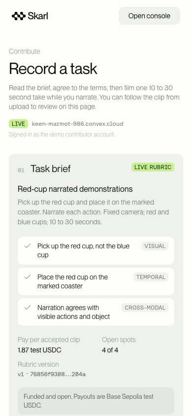
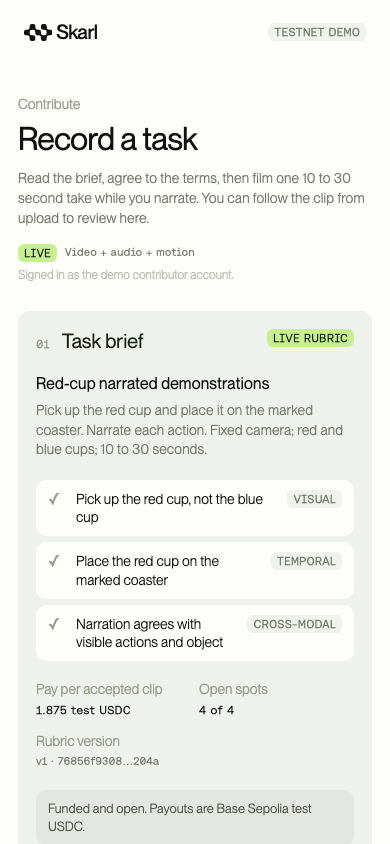

# Mobile capture and motion evidence

Skarl's standalone [Expo Go app](../apps/mobile/README.md) collects consented
10–30 second portrait task videos with narration and a synchronized IMU trace.
This is a **Base Sepolia testnet demo** with Google sign-in and an explicit
unsigned, impersonable contributor fallback. It creates ordinary licensed demo
contributions, never `verificationOnly` submissions. No wallet key, location data or new database is introduced.

## Authentication

Google is the only real sign-in provider. `ConvexAuthProvider` connects the
existing Convex client to auth, with tokens and the OAuth verifier in
`expo-secure-store`. The browser flow uses `expo-web-browser` and
`expo-auth-session`, both available in Expo Go. A signed-in account must claim
the contributor role before using contributor calls and always uses its own
membership; a missing or refused membership never becomes a demo identity.
Profile offers sign-out. The separate labeled demo entry remains unsigned and
works only while the server's demo mode permits it.

See [authentication setup](auth.md) for the Google Web application client,
Convex callback, environment variables and Expo Go's `exp://` return URL behavior.
Real Google callback delivery and native session persistence require credentials
and a physical-phone smoke test; local tests and exports cannot verify them.

## Why sensors

Embodied-AI data buyers can use synchronized video, audio and inertial signals
to study camera motion alongside visible actions. This thin slice preserves the
raw channels and exposes simple plotting summaries, without claiming that phone
motion measures hand or object motion. An accelerometer measures the camera
device, not the cup.

Attitude and gravity give labs camera orientation relative to gravity: the
rotational half of camera pose, without claiming camera translation, calibrated
world heading or full six-degree-of-freedom tracking. Live steadiness and horizon
coaching help contributors keep the fixed-camera task readable, with the goal
of fewer rejected takes; no reduction in rejections has been measured yet.

Motion can contribute to an anti-recapture investigation, but it is **not hardware
attested** and an uploaded trace can be fabricated. The current red-cup task asks
for a **fixed camera**, so a still IMU during pickup or placement is expected. We
therefore do not issue a “possible screen recapture” warning or force review from
that condition. Sensors can never recommend acceptance or authorize payment.

## Capture contract

The app requests 20 ms updates (~50 Hz) from available Accelerometer, Gyroscope,
DeviceMotion, and Magnetometer channels. Capture starts with the recording call and stops on
completion/interruption. Only actual sampled channels appear in `sensors`;
permission denial or unavailable hardware produces `sensors: []`, `samples: []`.
No location permission is requested, and the server rejects unknown JSON fields.

- `accelerometer`: x/y/z in **g**, including gravity; stationary magnitude ≈1 g.
- `gyroscope`: x/y/z in **radians/second**.
- `deviceMotion`: linear acceleration x/y/z in **m/s²**, excluding gravity.
- `attitude`: x/y/z store DeviceMotion `rotation.alpha/beta/gamma` in
  **radians**, respectively. These are Euler components, not a Cartesian vector
  (Expo alpha rotates about Z, beta about X, gamma about Y). They are not
  `rotationRate`, which uses degrees/second. Heading is device-reference-relative.
- `gravity`: x/y/z in **m/s²**, computed from the same DeviceMotion event as
  `accelerationIncludingGravity - acceleration`. Neither missing vector is
  assumed to be zero. These axes are phone-relative: X right, Y toward the top,
  Z out of the screen in portrait. Both new channels reuse the existing listener;
  no new native dependency or permission is added.
- `magnetometer` (v2 only): x/y/z magnetic field in **microteslas**. This is a
  phone-relative field vector useful for downstream heading estimation, not
  calibrated world heading; magnetic interference and mounting affect it.
- `timestampMs`: monotonic app callback time relative to the trace origin, using
  `performance.now()`. OS batching/dropped events can lower the effective rate.
  Native recording progress gates the 10-second stop.
- Metadata includes model, OS/version, app version, back camera, requested 720p
  quality and ISO `recordedAt`. Actual resolution/fps are optional; the app does
  not invent measurements that the camera API does not return.

JSON is uncompressed and capped at 2 MiB. It is stored privately in Convex;
only bounded metadata and summaries live in the submission document. The trace
schema is [sensorTrace.ts](../convex/lib/sensorTrace.ts), with Convex validators
in [sensorTraceValidators.ts](../convex/sensorTraceValidators.ts). This is a
separate evidence attachment; the canonical verification report JSON Schema and
Python report model are unchanged.

Version **1** remains valid, including old three-channel traces and clock-less
uploads. Version **2** adds the following fields; existing stored summaries need
no migration. Both versions retain the 2 MiB byte and 31,000-sample caps.

| Field | Meaning and training limits |
| --- | --- |
| `clock` | `js-callback-performance-now`; callback timestamps, not hardware IMU timestamps |
| `videoStartOffsetMs` | Estimated video zero in trace-clock milliseconds; `videoTimeMs = timestampMs - videoStartOffsetMs` |
| `videoStopOffsetMs` | Estimated end in the same clock; null together with start when no timing callback arrives |
| `syncSource` / `syncAccuracy` | `expo-recording-progress-estimate` / `approximate`; no claim of native frame accuracy |
| `segments` | Optional tap-derived `{label, startMs, endMs}` sub-tasks in **video-relative milliseconds**, using frozen order rubric descriptions; no taps yields `[]` |
| `context.mount` | Contributor-selected `handheld`, `chest`, or `head` |
| `context.dominantHand` | Contributor-selected `left` or `right` |
| `context.environment` | Contributor-selected `kitchen`, `desk`, `workshop`, or `other` |
| `context.lighting` | Contributor-selected `bright` or `dim` |
| `unavailableSensors` | Complement of actual sampled channels across all six names; failed registration or missing vectors never becomes a zero reading |
| `device.model` | `expo-device` model name; unknown remains unknown |
| `device.cameraFacing`, `requestedVideoQuality`, `requestedCodec`, `zoom` | Back camera, requested 720p / AVC, normalized Expo zoom; requests are distinct from measured file metadata |
| `device.fps`, `resolution`, `videoDurationMs`, `metadataSource` | Client-read file metadata from `expo-video` when available; absent/null when unavailable, never a default FPS |
| `device.codec` | Observed codec when exposed, otherwise null |
| `device.intrinsics` | Small iPhone-model FOV lookup projection (`fx`, `fy`, `cx`, `cy`, pixel dimensions and horizontal FOV), always `estimated: true`; null for unknown model/dimensions |

Expo Go's SDK 58 camera exposes native elapsed duration via recording progress,
but no native recording start/stop host-clock timestamp. The app estimates the
start from the minimum observed `callbackTime - nativeDuration`, limiting
positive bridge delay, and derives stop from file duration (or last native
progress when metadata is unavailable). This removes invocation latency from
the alignment estimate but **cannot guarantee frame-accurate synchronization**.
Device callback latency, IMU batching, variable frame rate and missing native
frame presentation timestamps remain limitations. Exports label their nominal
frame grid and sync basis; v1 is never silently assigned a zero sync offset.
True sensor/frame synchronization, ARKit camera poses and LiDAR depth require a
future native capture pipeline and are roadmap only.

Camera dimensions and estimated intrinsics use the encoded track's pixel axes
(`AVAssetTrack.naturalSize` on iOS). Browser hand keypoints use displayed-video
coordinates; converters must apply the video's display rotation before combining
these signals. No calibrated camera-to-hand transform is supplied.

Pre-capture selections persist locally between takes. Step taps request a haptic;
iOS may suppress it while the camera is active. Neither context, taps, intrinsics,
magnetic field nor estimated alignment can establish acceptance or payment authority.

## Live coaching

During recording, a lime pill shows **Steady** or **Hold still**. The latter
requires gyro magnitude >0.15 rad/s continuously for >500 ms; a sample gap
>250 ms resets that streak. Data older than 500 ms shows **Motion unavailable**,
never fabricated steadiness. A second pill says **Level the phone** when portrait
horizon roll exceeds 15°: `atan2(abs(gravity.x), abs(gravity.y))`. This ignores
forward pitch so pointing down at the task does not cause a warning. Roll is
unavailable when the gravity vector is zero or its XY projection is less than
10% of its magnitude (camera nearly straight up/down). Guidance resets each take
and never blocks recording, uploading or acceptance.

Steadiness coaching is visual only. [Expo's haptics documentation](https://docs.expo.dev/versions/latest/sdk/haptics/)
states that iOS disables the Taptic Engine while the camera is active to prevent
destabilization. The existing [Expo DeviceMotion API](https://docs.expo.dev/versions/latest/sdk/devicemotion/)
is included in Expo Go.

## Per-take spoken liveness

Opening the camera requests `liveness:issueChallenge` with
`{ demoIdentity: "contributor" }`. It returns `{ challengeId, words, expiresAt }`:
three common words and a two-minute expiry in Unix milliseconds. The preview
shows “Say these words while recording” in the landing-page typography and palette.
Say all three in order, then narrate the task. If less than a minute remains before
recording, the button requests fresh words and requires a second tap to record.
The words stay fixed during a take. Failed/interrupted recordings close the camera;
opening it again, including after a discarded take, issues a new challenge.

The saved draft sends `livenessChallengeId` with `submissions:create`. The server
atomically consumes that contributor's unexpired, unused challenge and stores
`liveness: { words, issuedAt, consumedAt }` on the submission. Submit promptly:
expiry is checked when creation commits, so time spent reviewing or uploading
counts toward the two minutes. An explicit expired/used/foreign/missing challenge
refusal permits discarding and recording fresh words; the app never assigns a
new code to old video. A timeout preserves the original request ID, storage IDs,
and challenge ID for an idempotent retry, including after challenge expiry.
Older saved drafts without the optional ID still submit for human review.

After transcription, deterministic matching checks the issued words in order,
ignoring case and punctuation, and records timestamped evidence without adding a
rubric criterion. Missing or failed liveness routes to `needs_review`, never an
automatic rejection or acceptance. Spoken instructions cannot declare a pass.
This adds a freshness signal; it does not establish hardware attestation or rule
out a generated or composited recording made after the code was issued. Original
sensor trace formats and optional sensor evidence remain unchanged.

## Upload and trust boundary

The client gets `submissions:generateUploadUrl`, POSTs the video and sensor JSON
using separate URLs, then calls `submissions:create` with the stable request UUID,
`demoIdentity: "contributor"` and `consentAcknowledged: true`. It calls
`sensorTraces:attachSensorTrace` with the created submission and uploaded trace.
The action validates stored bytes and derives the metadata/summary server-side.
A following internal mutation rechecks contributor ownership and tenant/consent
before attaching. Attachments are immutable, replay-safe and cannot be reused
for another submission; accepted/rejected contributions cannot gain new evidence.

The two steps are not atomic: video analysis can begin before sensor attachment.
The app labels that intermediate state and retries the attachment. Sensors are
optional advisory evidence, so this never changes the existing acceptance gate.
If a buyer or their policy decides before attachment, the server freezes evidence and
rejects the late attachment. That terminal error requires operator review; it
must not cause a second video submission.

Live `submissions:getReport` powers the status and timestamped criteria. The
contributor/owning-buyer-only `media:submissionEvidence` returns `sensorTrace` or null.
Its signed-by-possession storage URL is private bearer access: do not cache or
publish it. Signed-in calls use their own persisted membership. Unsigned demo
identities remain impersonable and are not authentication.

## Motion summary for the dashboard

See the [exact API handoff](dashboard-api.md#mobile-sensor-evidence). RMS magnitude
is computed over each channel's samples, both globally and in 250 ms bins.
Missing channels are `null`, not zero. Active bins have any sample satisfying:
`abs(accelMagnitudeG - 1) > 0.08`, gyro magnitude >0.15 rad/s, or linear
acceleration >0.8 m/s². Contiguous active bins merge into intervals. These are
simple uncalibrated plotting heuristics, not a classifier or provenance proof.
Attitude and gravity do not activate those bins: gravity is expected even for
a motionless phone. The global summary also includes optional nullable
`meanTiltDegrees` (mean valid portrait horizon roll, as defined above) and
`steadinessRatio` (fraction of gyro samples with magnitude ≤0.15 rad/s, from 0
to 1). The ratio is sample-weighted, not elapsed-time-weighted or the UI's
500 ms sustained-warning rate. Missing channels yield null; old stored summaries
can omit both fields. Neither metric changes acceptance or payment authority.

## Verification and deployment

Local strict TypeScript and the iOS Metro/Hermes export are build checks. Synthetic
backend tests cover content validation, rate/size caps, monotonic timestamps,
ownership, replay/immutability and non-authority over acceptance/payments. Mobile
retry tests exercise loss of a create/attach response, preserve the original
challenge through an uncertain creation, and permit retaking after explicit
liveness refusals. None establish a physical iPhone capture, live model inference or payment.

**A Convex deployment from main is required** for the optional submission fields,
index, sensor action, v2 sync/context/segment metadata, magnetometer validators/summary fields, liveness challenge
mutation and deterministic verifier gate. Deploy the backend before using the
updated client's v2 uploads or challenge fetch; an older backend cannot
serve those requests. The mobile work does not deploy Convex. The operator
should deploy, then follow the [phone smoke test](../apps/mobile/README.md#phone-smoke-test).
Also check that fresh words appear on camera open and retake, stay readable over
the live preview while filming, survive a lost-create retry, and produce an
explicit retake path if upload finishes after expiry. Record one valid sequence,
one wrong-order sequence and one silent take; inspect timestamped liveness
results and confirm the latter two require review. These require a human device
and live transcription test; local tests and exports do not establish them.

## Visual alignment

Native tokens in [theme.ts](../apps/mobile/theme.ts) match the landing page's
paper/mist/haze/slate palette, with lime reserved for live or accepted evidence,
recording and selection. The app uses the actual Montreal and Fono fonts,
converted from the web WOFF2s to OTF with FontTools, and the same seven-cell logo.
Body copy, task cards, 18px gutters and 12px card corners mirror the contributor
page. The native stepper and evidence lanes use that same visual language.
Motion uses `Easing.bezier(.43, .42, .37, .97)` and respects Reduce Motion.

These screenshots compare the **real web-exported Expo UI** against
[the deployed contributor page](https://skarl.devshardat.work/contribute), both at
390 × 844 CSS pixels. Both loaded the live demo rubric; no submission or camera
capture was fabricated for the screenshots. The app adds explicit testnet and
sensor labels, and displays the exact 1.875 test-USDC rate in mono (the web rounds
its display). A browser layout render does not establish native camera behavior.

| Deployed web reference | Expo UI (web export) |
| --- | --- |
|  |  |

[Side-by-side comparison](mobile/comparison-390.png) ·
[Consent and recording screen](mobile/expo-consent-record-390.png).
